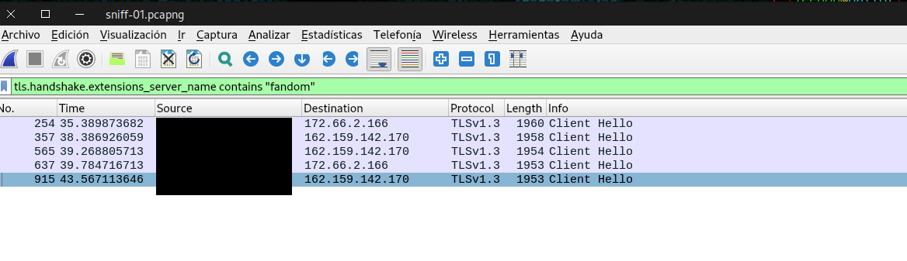
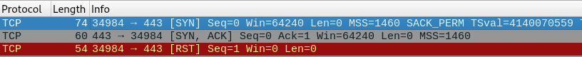
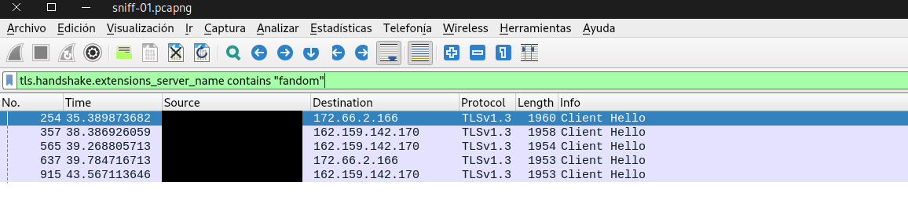
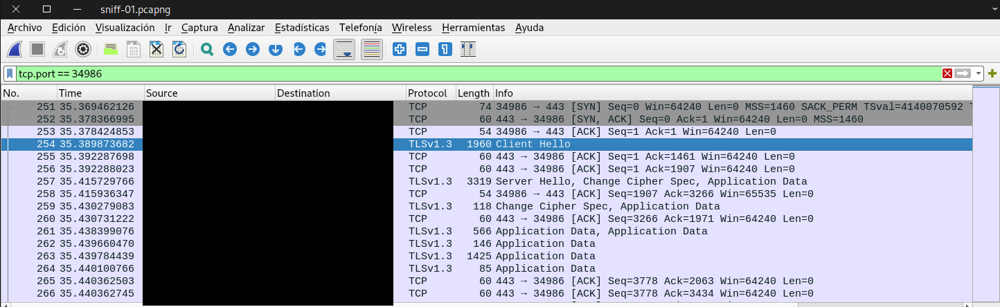
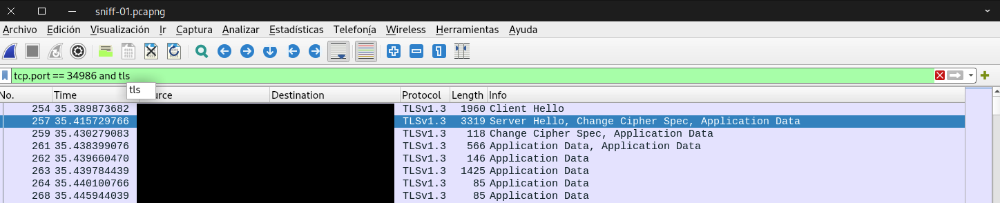
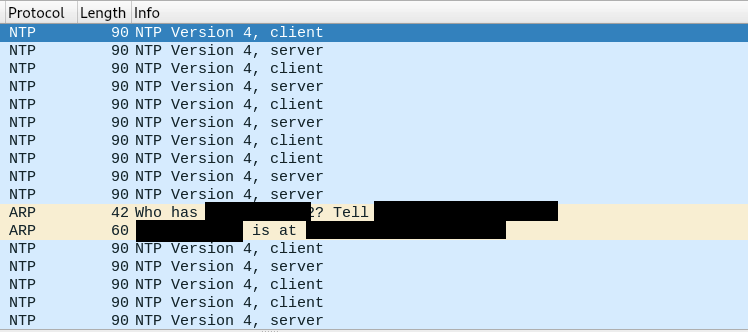

# 01 · sniff

Capturo mi propio tráfico y explico qué ocurre entre que escribo un dominio y la web aparece en pantalla.

**Dominio analizado:** `aesthetics.fandom.com`

## 1. Entorno

Capturé con Wireshark en una máquina virtual con Parrot OS, ejecutada con VMware en mi Mac. Usé la interfaz `ens33`.

Elegí `ens33` porque es la única interfaz de red real de la VM. La otra, `lo`, es el *loopback*: solo lleva el tráfico de la máquina consigo misma, así que por ella no pasa la conexión a internet.

Elegí la VM para limitar la captura al tráfico de ese sistema y exponer menos datos personales. A cambio, renuncié a ver el tráfico del host y añadí una capa más de NAT.

La VM usa el modo de red "Share with my Mac", es decir, NAT. Está en una red privada virtual creada por VMware, `172.16.x.0/24`.

- **Lo que veo:** el tráfico de la propia VM y sus intercambios con la puerta de enlace virtual.
- **Lo que no veo:** el tráfico del Mac, el de otros dispositivos de casa y lo que ocurre después del NAT de VMware.

## 2. DNS

Filtré las consultas de mi dominio con `dns.qry.name contains "fandom"`.



| Pregunta | Respuesta |
| --- | --- |
| Servidor que responde | `172.16.x.2`, la puerta de enlace de VMware |
| Tipos de registro pedidos | `A` (IPv4), `AAAA` (IPv6) y `HTTPS` (datos para conectar por HTTPS) |
| Transporte y puerto | UDP, puerto 53 |
| Puerto de origen de la consulta `0xaf30` | `57801`, un puerto temporal de mi sistema |
| IP devueltas en el registro `A` | `162.159.142.170` y `172.66.2.166` |

El servidor DNS coincide con la puerta de enlace: la VM pregunta a VMware, no directamente al DNS de mi operadora. Lo que VMware haga después con la consulta no se ve desde la VM.

El dominio no apunta directamente a una IP. La respuesta incluye un CNAME, un alias, hacia `fandom.com.cdn.cloudflare.net`. Esto indica que la web se sirve a través de Cloudflare, una CDN: una red de servidores repartidos por el mundo que entregan el contenido desde un punto cercano.

Cada respuesta lleva el mismo identificador que su consulta. Por ejemplo, `0xaf30` responde a `0xaf30`. Las respuestas no llegan en el mismo orden en que se preguntó, así que este identificador permite emparejarlas.

La captura muestra tres tandas de consultas para el mismo dominio. No he confirmado la causa. Mi hipótesis es que proceden de distintos procesos del navegador o del sistema.

**¿Es siempre la misma IP?** Las tres respuestas `A` de la captura devolvieron las mismas dos IP. Una consulta posterior con dig devolvió las mismas IP, y también el CNAME hacia Cloudflare.

## 3. TCP

Filtré el tráfico de las IP devueltas por DNS:

`ip.addr == 162.159.142.170 or ip.addr == 172.66.2.166`

Los tres primeros paquetes no forman una conexión completa: tras `SYN` y `SYN, ACK`, mi VM envió `RST` en lugar de `ACK`, y cortó la conexión de golpe.



No he confirmado la causa. Mi hipótesis es que el navegador abre varias conexiones en paralelo y corta las que no necesita.

Para encontrar la conexión que sí funcionó, busqué el primer mensaje TLS del navegador, que incluye el nombre de la web:

`tls.handshake.extensions_server_name contains "fandom"`



El primero es el paquete 254, con puerto de origen `34986` y destino `172.66.2.166`. Después aislé esa conexión con `tcp.port == 34986`:



| Paquete | Quién habla | Flags | Para qué sirve |
| --- | --- | --- | --- |
| 251 | VM → NAT de VMware | `SYN` | Pide abrir la conexión y propone su número de secuencia inicial |
| 252 | NAT de VMware → VM | `SYN, ACK` | Acepta, confirma lo recibido y propone su número de secuencia inicial |
| 253 | VM → NAT de VMware | `ACK` | Confirma, y la conexión queda abierta |

- **`SYN`** (*synchronize*): sincroniza la numeración, que sirve para ordenar los datos y detectar los que se pierden.
- **`ACK`** (*acknowledge*): confirma lo recibido.
- **`FIN`:** cierra la conexión de forma ordenada. No aparece en este saludo.
- **`RST`** (*reset*): corta la conexión de golpe.

**Quién responde en realidad:** aunque el destino del paquete 251 es la IP de Cloudflare, todo indica que el `SYN, ACK` lo envía el NAT de VMware. El paquete 252 llega con un TTL de 128 exacto, es decir, sin haber pasado por ningún router, y trae muy pocas opciones TCP. Es una evidencia fuerte, aunque no una prueba absoluta. VMware probablemente abre otra conexión con Cloudflare, pero esa no se ve desde la VM.

**Puertos:** el destino es el `443` porque es el puerto estándar de HTTPS. El origen, `34986`, es un puerto temporal elegido por mi sistema para distinguir esta conexión de las demás.

## 4. TLS

TLS comienza en el paquete 254, con el `Client Hello`. El cifrado empieza dentro del paquete 257, justo después del `Server Hello`.



**Información sin cifrar en el inicio:**

- El nombre de la web (SNI): `aesthetics.fandom.com`.
- Las versiones de TLS que ofrece mi navegador: 1.3 y 1.2.
- Las opciones de cifrado: 17 *cipher suites*.
- Las IP y los puertos, que van en las capas inferiores, fuera de TLS.

Sé que estos datos van sin cifrar porque Wireshark los muestra campo por campo sin tener ninguna clave. En cambio, de `Application Data` solo puede mostrar datos cifrados.

**Lo que eligió el servidor en el paquete 257:** TLS 1.3 y `TLS_AES_128_GCM_SHA256`. El campo `key_share` aporta el material para que ambos lados generen una clave común sin enviarla por la red.

**Privacidad:** el cifrado protege el contenido, pero no oculta a qué web me conecto. Además, mis consultas DNS también viajaron sin cifrar por el puerto 53, así que el dominio ya era visible antes de TLS.

| Quien observa mi tráfico HTTPS puede saber | No puede saber |
| --- | --- |
| Mi IP y la del servidor | La página exacta dentro de la web (la ruta de la URL) |
| Los puertos | El contenido |
| El nombre de la web (SNI) | Cookies y contraseñas |
| Cuándo me conecto y cuántos datos muevo | Lo que escribo en formularios |

## 5. Direccionamiento y NAT

| Dato | Valor |
| --- | --- |
| IP privada | `172.16.x.131` |
| Puerta de enlace | `172.16.x.2` |
| IP de destino | `172.66.2.166` |

En mi caso hay dos traducciones de direcciones:

```text
VM → NAT de VMware en el Mac → NAT del router de casa → Cloudflare
```

Mi IP privada solo tiene sentido dentro de mi red local, así que no puede usarse en internet. Cuando un paquete sale, el NAT sustituye la IP de origen por la suya y apunta la conexión en una tabla para devolver la respuesta al equipo correcto. En mi caso ocurre dos veces, en el NAT de VMware y en el router de casa, y por eso Cloudflare solo ve la IP pública del router.

## 6. Lo que no esperaba

El primer `Client Hello` de mi dominio llegó a los 35 segundos, y no abrí el navegador hasta pasados unos 30. Para buscar tráfico que no generé directamente, filtré ese periodo con `frame.time_relative < 30`.



### Flujo 1: NTP

- **Qué es:** *Network Time Protocol*. La VM consulta la hora exacta a servidores de tiempo.
- **Qué lo genera:** el servicio `ntpsec`, confirmado con `systemctl`.
- **¿Es normal?** Sí. Muchos sistemas dependen de un reloj correcto, como los certificados de TLS y los logs. Se repite varias veces en pocos segundos. Mi hipótesis es que `ntpsec` consulta varios servidores a la vez, pero no lo he confirmado.

### Flujo 2: ARP

- **Qué es:** *Address Resolution Protocol*. Un equipo pregunta quién tiene una IP para conocer su dirección MAC dentro de la red local.
- **Qué lo genera:** el propio sistema operativo, no una aplicación.
- **¿Es normal?** Sí. La VM necesita la MAC de la puerta de enlace para enviarle paquetes.

## 7. Filtros

| Filtro | Para qué sirve |
| --- | --- |
| `dns.qry.name contains "fandom"` | Mostrar solo los paquetes DNS del dominio elegido |
| `ip.addr == 162.159.142.170 or ip.addr == 172.66.2.166` | Mostrar el tráfico desde o hacia las IP devueltas por DNS |
| `tls.handshake.extensions_server_name contains "fandom"` | Encontrar los `Client Hello` del dominio mediante el campo SNI |
| `tcp.port == 34986` | Aislar una conexión TCP completa |
| `tcp.port == 34986 and tls` | Ver solo los paquetes TLS de esa conexión |
| `frame.time_relative < 30` | Ver el tráfico de los primeros 30 segundos, antes de abrir el navegador |

